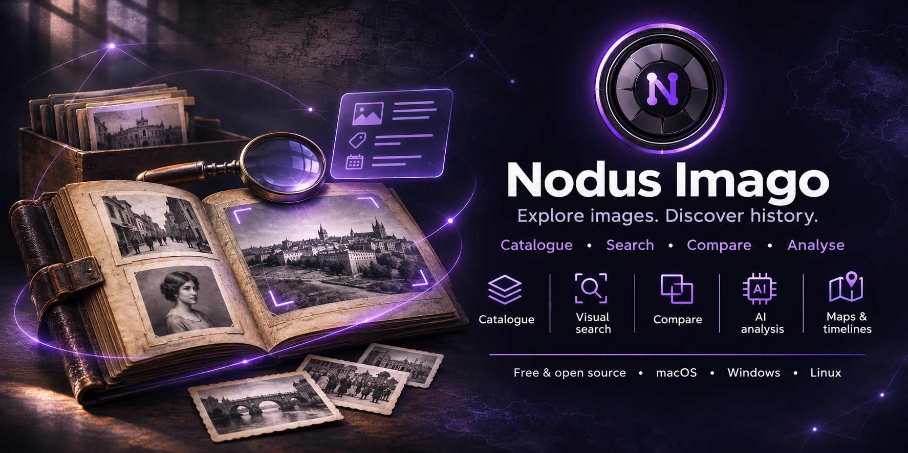
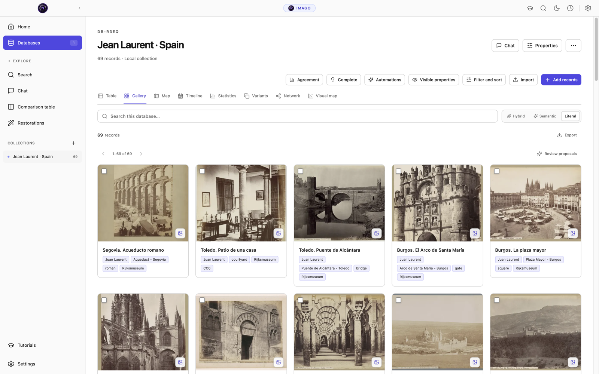
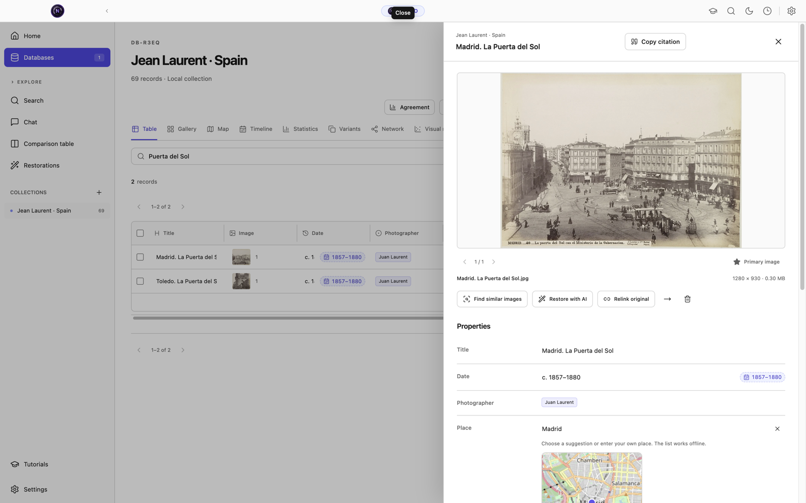
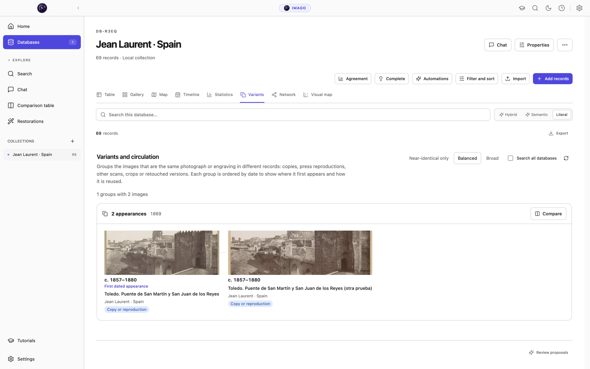
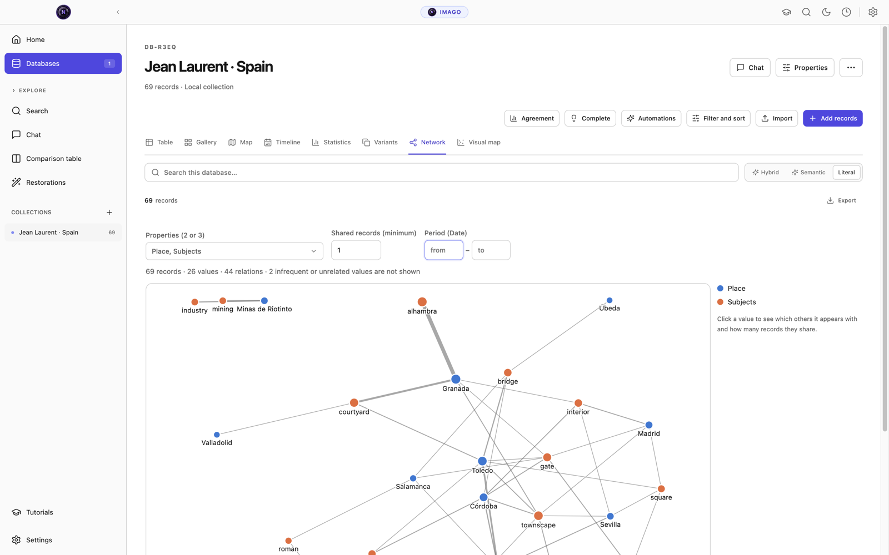
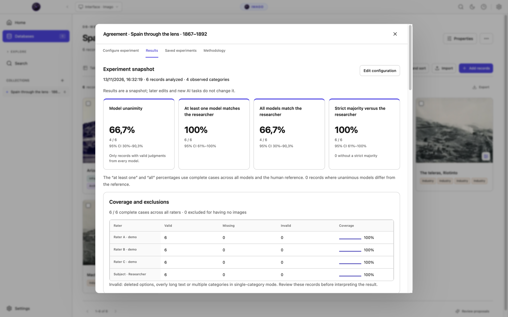
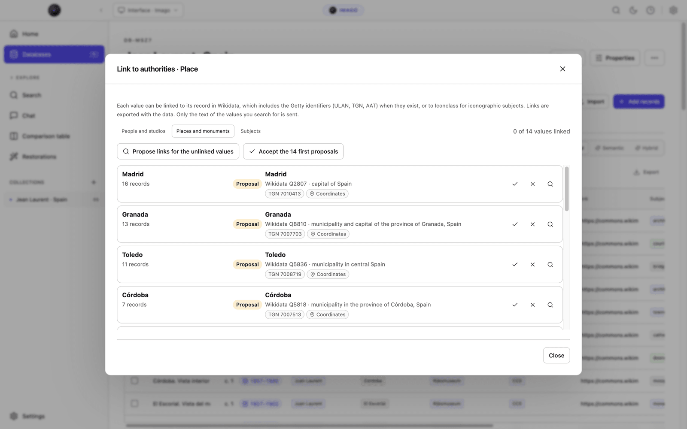

<p align="center">
  
</p>

<p align="center">
  <a href="https://github.com/jorgepb96/nodus-imago/releases/latest"></a>
  <a href="https://github.com/jorgepb96/nodus"></a>
  <a href="https://github.com/jorgepb96/nodus-imago/releases"></a>
</p>
<p align="center">
  <a href="https://github.com/jorgepb96/nodus-imago/releases/latest"></a>
  <a href="https://github.com/jorgepb96/nodus-imago/actions/workflows/ci.yml"></a>
  <a href="LICENSE"></a>
</p>

Nodus Imago is an open-source desktop application for historians, art historians and archivists who work with photographs, engravings and other images. It keeps your images and their catalogue records together, and helps you date, compare, search and analyse them.

Everything stays on your computer. There is no account and no server. AI features can run locally, and external providers are used only if you turn them on. Imago is part of the [Nodus](https://github.com/jorgepb96/nodus) family and works on its own.

## Install Nodus Imago

Download the installer for your computer and open it. There is no server to configure and no account is required to begin.

| Platform | Latest installer | Total downloads | Latest version downloads |
| --- | --- | ---: | ---: |
| macOS with Apple silicon | [Download DMG](https://github.com/jorgepb96/nodus-imago/releases/latest/download/Nodus-Imago-mac-arm64.dmg) |  |  |
| macOS with an Intel processor | [Download DMG](https://github.com/jorgepb96/nodus-imago/releases/latest/download/Nodus-Imago-mac-x64.dmg) |  |  |
| Windows 10 and 11 | [Download EXE](https://github.com/jorgepb96/nodus-imago/releases/latest/download/Nodus-Imago-win-x64.exe) |  |  |
| Ubuntu and Debian | [Download DEB](https://github.com/jorgepb96/nodus-imago/releases/latest/download/Nodus-Imago-linux-amd64.deb) · [ARM64](https://github.com/jorgepb96/nodus-imago/releases/latest/download/Nodus-Imago-linux-arm64.deb) |  |  |
| Fedora, openSUSE and other RPM-based distributions | [Download RPM](https://github.com/jorgepb96/nodus-imago/releases/latest/download/Nodus-Imago-linux-x86_64.rpm) · [ARM64](https://github.com/jorgepb96/nodus-imago/releases/latest/download/Nodus-Imago-linux-aarch64.rpm) |  |  |
| Other Linux distributions | [Download AppImage](https://github.com/jorgepb96/nodus-imago/releases/latest/download/Nodus-Imago-linux-x86_64.AppImage) · [ARM64](https://github.com/jorgepb96/nodus-imago/releases/latest/download/Nodus-Imago-linux-arm64.AppImage) |  |  |
| **Total** | |  |  |

- **macOS:** the app is signed and notarized by Apple, so it opens like any other app. Choose Apple silicon for M-series Macs and Intel for older ones.
- **Windows:** the installer is not yet signed with a code-signing certificate. If Windows SmartScreen shows a warning, choose **More info › Run anyway**.
- **Linux:** the DEB and RPM packages install from your system's package tools. For the AppImage, allow it to run as a program (`chmod +x`) and open it.

Imago checks for new versions and installs them when you choose to; in **Settings › Updates and news** you can also let it download them automatically. Every version, with its notes and all files, is on the [releases page](https://github.com/jorgepb96/nodus-imago/releases). You can also [run Imago from source](#development).

## Catalogue, describe and tag your images

Every image has a catalogue record with the fields you choose: text, dates, places, people, single tags and multiple tags. Edit them in the table, in the gallery or in the record itself.

Bring in a CSV or TSV file, a Notion export, a Nodus database, a Tropy project or a IIIF manifest from a digital library. Images are matched to their records by file name, and originals are never modified.

Dates stay as cataloguers write them: “c. 1860”, “[1930]”, “1950s”, “before 1936”. Imago reads the period and how certain it is, and uses it in filters, sorting, the timeline and statistics.

An AI model can describe images, tag them with your own vocabulary, or transcribe backs, stamps, inscriptions and captions, one record or many at a time. Results are proposals: nothing changes until you approve them.





## Find images by words, by likeness or by a detail

Search by exact words, by meaning (“procession with lanterns”) or with an image. Mark a region of a photograph, write a note, and search for that detail inside every other image: Imago shows where it appears.


## See the whole collection at once

The visual map places every image by likeness, so similar photographs sit together. Colour it by place, subject or year, zoom in to see the images and select an area to compare or analyse it.


## Follow a photograph through its copies

The Variants view finds the same photograph in different records: other prints, scans and crops, in date order. The comparison table puts up to six images side by side with shared zoom, or lays one over another to show what changed.




## Places, viewpoints and then and now

Place records on a map with the direction the camera faced, and find photographs taken from the same spot. Then and now shows present-day photographs of the place from Wikimedia Commons next to the historical one.


## Dates, patterns and relations

The timeline orders records by period and marks approximate and attributed dates. Statistics give frequencies, cross-tabs with chi-square and Cramér’s V, co-occurrence and trends. The network shows which places, people and subjects appear together.





The Agreement tool compares the categories assigned by several AI models with each other and with your own classification (Cohen’s and Fleiss’ kappa, Krippendorff’s alpha). *The screenshot uses illustrative labels; its figures are not an evaluation of any model.*

## Clean and link your catalogue

Unify values written in different ways (“N. Muller”, “Muller, Nicolás”) in one step, and undo it if needed. Link people, places and subjects to Wikidata, with their Getty identifiers, and to Iconclass. Linked places can place every record on the map.



Complete empty fields from the most similar images: Imago proposes a value, such as an attributed period “[1950–1955]”, and shows the images it is based on.

## Restore without touching the original

Create restored, repaired or colourised versions of an image, or of one region, with an image model from OpenAI, Gemini or OpenRouter. Versions are kept apart from the original and can be downloaded with an “AI modified” watermark.

## Cite and publish

Copy a citation built from a template (Chicago, ISO 690 or APA). Export a PDF of plates with numbered figures and captions, and export annotations as W3C Web Annotations.

## Ask questions in the chat

Ask about your databases in plain language. When an answer needs an exact figure, the model writes a calculation that runs over every record in an isolated process on your computer, and the answer shows it.

## Local AI or a provider of your choice

| Purpose | Local model |
| --- | --- |
| Image descriptions and classification | LFM3-VL-2B through llama.cpp |
| Text and image embeddings | EmbeddingGemma 2 through Transformers.js / ONNX Runtime |
| Embeddings on Intel Macs | Harrier OSS v1 0.6B through llama.cpp |

Models download only when you ask, are verified before use and do not need Python. You can also use OpenRouter, Google Gemini, Ollama, LM Studio or another OpenAI-compatible server. Provider keys are stored in the operating system’s encrypted storage.


## Back up and export

Export tables as CSV, JSON or XLSX. Full `.imago` backups keep the structure, originals, notes, history and search index; they can be scheduled and encrypted. When backups are set up, Imago makes one before installing an update.

## Development

You need **Node.js 22.12 or later** and npm.

```sh
npm ci
npm run dev                # development application
npm run verify             # typecheck, lint, unit tests and build
npm run test:desktop:all   # desktop flows; needs a graphical session
```

Imago is built with Electron, React, TypeScript and SQLite. The [CI workflow](.github/workflows/ci.yml) tests the source and the packaged applications on macOS, Windows and Linux. Releases are built, signed and published by the [release workflow](.github/workflows/release-draft.yml); the macOS Intel build is added afterwards by [its own workflow](.github/workflows/release-macos-intel.yml). The [verification record](docs/VERIFICATION.md) describes what has been tested.

## Report a problem or contribute

[Open an issue](https://github.com/jorgepb96/nodus-imago/issues/new/choose) with your app version, your platform and the steps that reproduce it. Product feedback goes in the [shared feedback thread](https://github.com/jorgepb96/nodus-imago/issues/1), and security problems are reported [privately](SECURITY.md). Do not include private research material or API keys.

Imago follows the same contribution rules as Nodus Research: every pull request is in English, addresses an existing issue and passes the required checks. Read [CONTRIBUTING.md](CONTRIBUTING.md) and [AGENTS.md](AGENTS.md) before opening one.

## Image credits

The screenshots show photographs by Jean Laurent and his studio (1850s–1880s) from the **Rijksmuseum** (CC0), the **Library of Congress** and other holdings on Wikimedia Commons (public domain), and from the **Biblioteca Nacional de España** (public domain or CC BY 4.0), retrieved through Wikimedia Commons. Every image, its source and its rights are listed in the [screenshot notes](docs/screenshots/README.md). Titles, places and subjects were entered for the demonstration. None of these institutions sponsors or endorses Nodus Imago.

## License

Nodus Imago is © Jorge Pérez Burgueño and licensed under [AGPL-3.0-only](LICENSE). Adapted Nodus components keep their attribution; see the [reuse notes](docs/REUSE.md) and [third-party notices](THIRD_PARTY_NOTICES.md). Dependencies, photographs and optional models keep their own licenses. LFM3 uses the [LFM Open License 1.0](legal/LFM-Open-License-1.0.txt); model weights are not included with the app.

Contributions require acceptance of the [Contributor License Agreement](CLA.md).
Contributors retain ownership and grant the maintainer permission to sublicense
and relicense their contributions, including under commercial terms. See
[CONTRIBUTING.md](CONTRIBUTING.md#accepting-the-cla) for the acceptance process.
