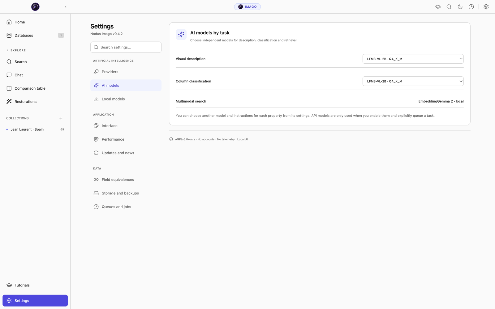
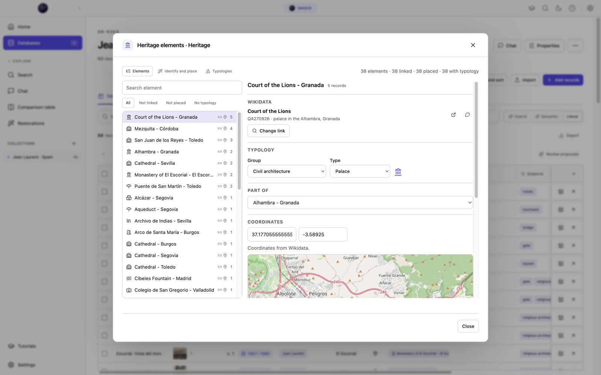
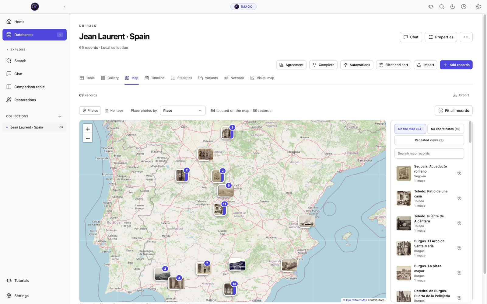
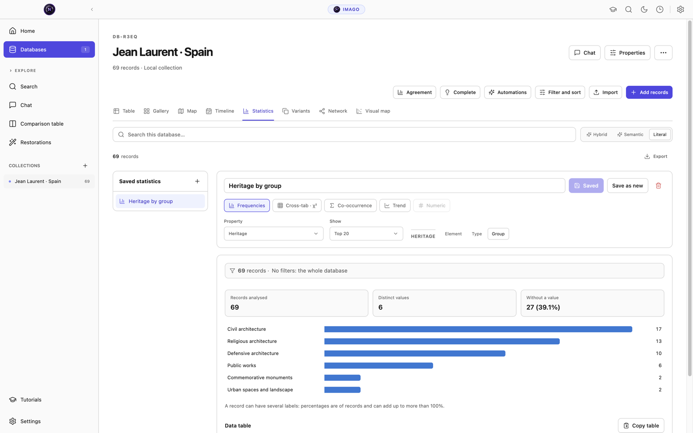
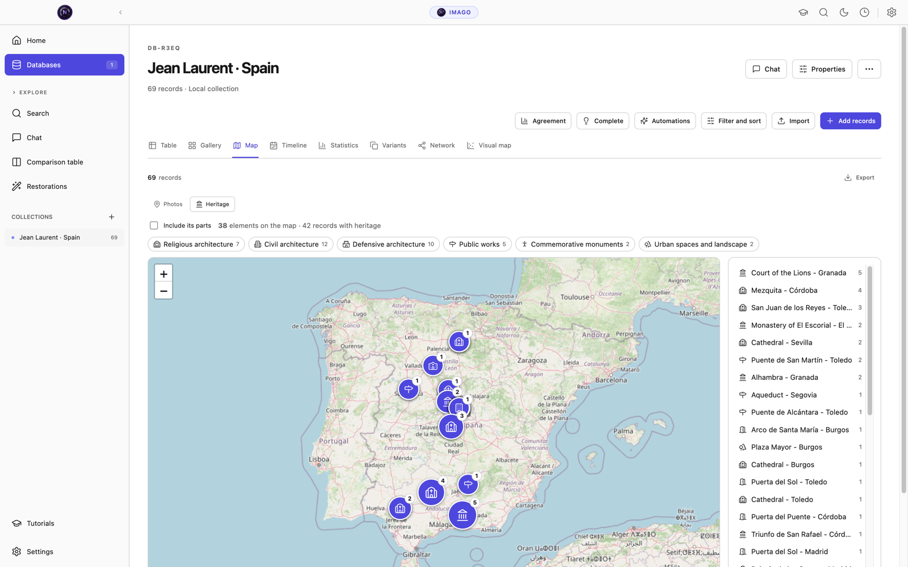
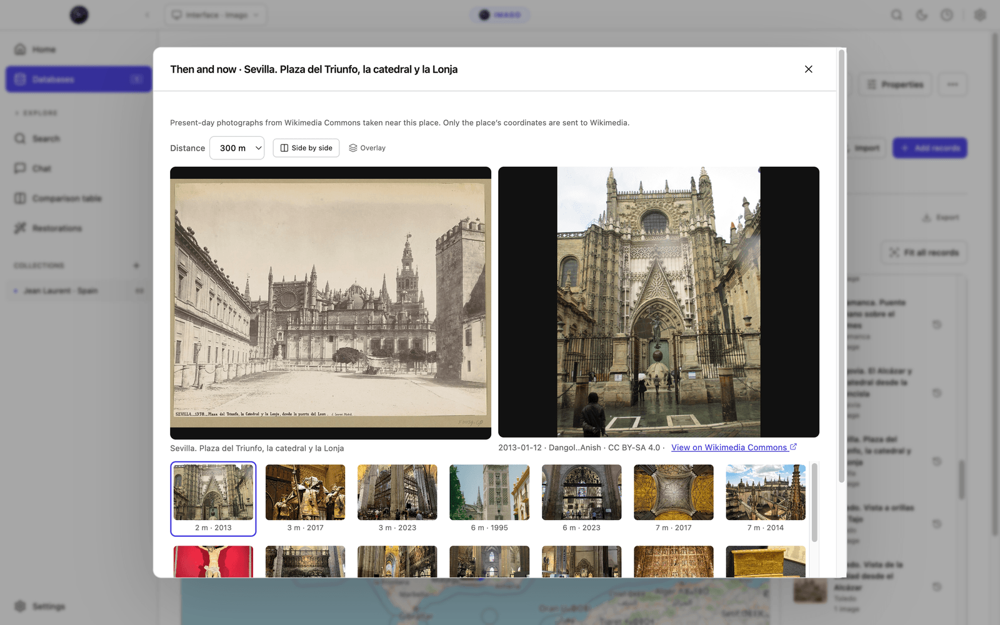
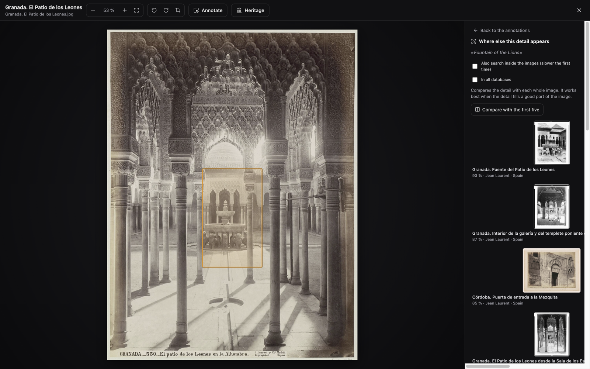
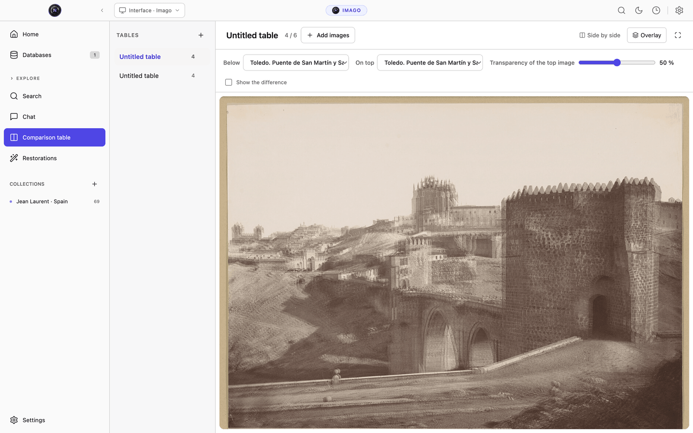
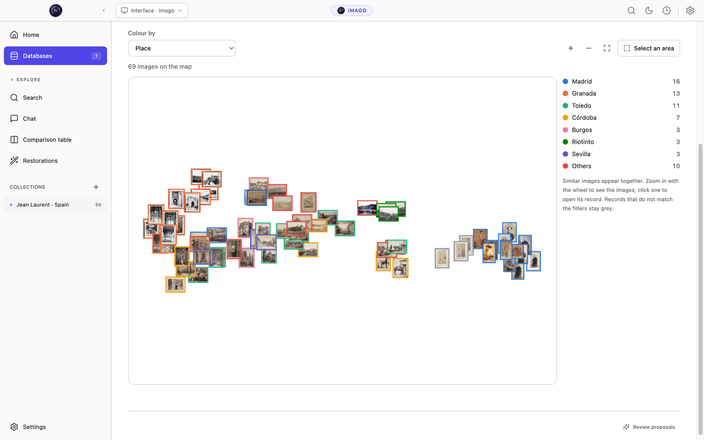

<p align="center">
  
</p>

<p align="center">
  <a href="https://github.com/jorgepb96/nodus-imago/releases/latest"></a>
  <a href="https://github.com/jorgepb96/nodus"></a>
  <a href="https://github.com/jorgepb96/nodus-imago/releases"></a>
</p>
<p align="center">
  <a href="https://github.com/jorgepb96/nodus-imago/releases/latest"></a>
  <a href="https://github.com/jorgepb96/nodus-imago/actions/workflows/ci.yml"></a>
  <a href="LICENSE"></a>
</p>

Nodus Imago is an open-source desktop application for historians, art historians and archivists who work with photographs, engravings and other images. It keeps your images and their catalogue records together, and helps you date, compare, search and analyse them.

Everything stays on your computer. There is no account and no server. AI features can run locally, and external providers are used only if you turn them on. Imago is part of the [Nodus](https://github.com/jorgepb96/nodus) family and works on its own.

## Install Nodus Imago

Download the installer for your computer and open it. There is no server to configure and no account is required to begin.

| Platform | Latest installer | Total downloads | Latest version downloads |
| --- | --- | ---: | ---: |
| macOS with Apple silicon | [Download DMG](https://github.com/jorgepb96/nodus-imago/releases/latest/download/Nodus-Imago-mac-arm64.dmg) |  |  |
| macOS with an Intel processor | [Download DMG](https://github.com/jorgepb96/nodus-imago/releases/latest/download/Nodus-Imago-mac-x64.dmg) |  |  |
| Windows 10 and 11 | [Download EXE](https://github.com/jorgepb96/nodus-imago/releases/latest/download/Nodus-Imago-win-x64.exe) |  |  |
| Ubuntu and Debian | [Download DEB](https://github.com/jorgepb96/nodus-imago/releases/latest/download/Nodus-Imago-linux-amd64.deb) · [ARM64](https://github.com/jorgepb96/nodus-imago/releases/latest/download/Nodus-Imago-linux-arm64.deb) |  |  |
| Fedora, openSUSE and other RPM-based distributions | [Download RPM](https://github.com/jorgepb96/nodus-imago/releases/latest/download/Nodus-Imago-linux-x86_64.rpm) · [ARM64](https://github.com/jorgepb96/nodus-imago/releases/latest/download/Nodus-Imago-linux-aarch64.rpm) |  |  |
| Other Linux distributions | [Download AppImage](https://github.com/jorgepb96/nodus-imago/releases/latest/download/Nodus-Imago-linux-x86_64.AppImage) · [ARM64](https://github.com/jorgepb96/nodus-imago/releases/latest/download/Nodus-Imago-linux-arm64.AppImage) |  |  |
| **Total** | |  |  |

- **macOS:** the app is signed and notarized by Apple, so it opens like any other app. Choose Apple silicon for M-series Macs and Intel for older ones.
- **Windows:** the installer is not yet signed with a code-signing certificate. If Windows SmartScreen shows a warning, choose **More info › Run anyway**.
- **Linux:** the DEB and RPM packages install from your system's package tools. For the AppImage, allow it to run as a program (`chmod +x`) and open it.

Imago checks for new versions and installs them when you choose to; in **Settings › Updates and news** you can also let it download them automatically. Every version, with its notes and all files, is on the [releases page](https://github.com/jorgepb96/nodus-imago/releases). You can also [run Imago from source](#development).

## What Imago is for

### 1. Catalogue your collection

Every image has a record with the fields you choose: text, dates, places, people and tags, edited in the table, the gallery or the record. Bring in CSV, Notion, Nodus, Tropy or IIIF; images find their records by file name and originals are never modified. Dates stay as cataloguers write them (“c. 1860”, “[1930]”, “1950s”, “1939–1949”) and Imago reads their period and certainty.


### 2. Describe and tag with AI, under your supervision

An AI model describes images, tags them with your own vocabulary or transcribes backs, stamps and inscriptions, one record or thousands. You choose the model and the instructions, see each result appear in its cell, and undo what you do not want; batch automations wait as proposals until you approve them. Models can run on your computer or with the provider you choose.



### 3. Identify heritage and find it by sight

A **Heritage** property turns the monuments, buildings, streets and artworks in your photographs into identified elements: linked to Wikidata, with coordinates, a typology with icons (religious, civil, defensive…) and what each one is part of. Imago identifies a whole list in the background, with Wikidata and OpenStreetMap, and keeps every proposal for you to review. Mark an element on the photograph, ask a vision model which ones appear, or select a detail and find it in every other image.



### 4. Place everything on the map

Place records with OpenStreetMap maps and a built-in gazetteer that works offline, including the direction the camera faced. Show photographs where they were taken or where the monument they show stands, see one point per heritage element, find photographs taken from the same spot, and compare them with present-day views from Wikimedia Commons.



### 5. Measure the collection

Frequencies, cross-tabs with chi-square and Cramér’s V, co-occurrence, trends and networks, by heritage element, type or group, always over the records your filters show. The timeline draws periods as recorded, and the Agreement tool compares several AI models with your own classification.



## And also

- **Search** by exact words, by meaning (“procession with lanterns”) or with an image; the **visual map** places every image by likeness.
- **Variants** find the same photograph in other prints, scans and crops; the **comparison table** shows up to six side by side or lays one over another.
- **Clean and link**: unify values written in different ways, link people, places and subjects to Wikidata (with Getty identifiers) and Iconclass, and complete empty fields from the most similar images.
- **Restore** or colourise a copy with an image model, never the original, with an “AI modified” watermark on downloads.
- **Cite and publish**: citations in Chicago, ISO 690 or APA, PDF plates with numbered figures, W3C Web Annotations.
- **Ask the chat** about your databases; exact figures come from a calculation run over every record on your computer.
- **Back up and export**: CSV, JSON or XLSX, and full `.imago` backups that can be scheduled and encrypted.
- **Guided tutorials** walk you through each task on the real interface.

<table>
  <tr>
    <td width="33%"><br><sub>Record, historical date and citation</sub></td>
    <td width="33%"><br><sub>Heritage map by typology</sub></td>
    <td width="33%"><br><sub>Then and now</sub></td>
  </tr>
  <tr>
    <td width="33%"><br><sub>Search a detail in every image</sub></td>
    <td width="33%"><br><sub>Comparison table</sub></td>
    <td width="33%"><br><sub>Variants of a photograph</sub></td>
  </tr>
  <tr>
    <td width="33%"><br><sub>Network of places and subjects</sub></td>
    <td width="33%"><br><sub>Visual map by likeness</sub></td>
  </tr>
</table>

### Local AI or a provider of your choice

| Purpose | Local model |
| --- | --- |
| Image descriptions and classification | LFM3-VL-2B through llama.cpp |
| Text and image embeddings | EmbeddingGemma 2 through Transformers.js / ONNX Runtime |
| Embeddings on Intel Macs | Harrier OSS v1 0.6B through llama.cpp |

Models download only when you ask, are verified before use and do not need Python. You can also use OpenRouter, Google Gemini, Ollama, LM Studio or another OpenAI-compatible server. Provider keys are stored in the operating system’s encrypted storage.

## Development

You need **Node.js 22.12 or later** and npm.

```sh
npm ci
npm run dev                # development application
npm run verify             # typecheck, lint, unit tests and build
npm run test:desktop:all   # desktop flows; needs a graphical session
```

Imago is built with Electron, React, TypeScript and SQLite. The [CI workflow](.github/workflows/ci.yml) tests the source and the packaged applications on macOS, Windows and Linux. Releases are built, signed and published by the [release workflow](.github/workflows/release-draft.yml); the macOS Intel build is added afterwards by [its own workflow](.github/workflows/release-macos-intel.yml). The [verification record](docs/VERIFICATION.md) describes what has been tested.

## Report a problem or contribute

[Open an issue](https://github.com/jorgepb96/nodus-imago/issues/new/choose) with your app version, your platform and the steps that reproduce it. Product feedback goes in the [shared feedback thread](https://github.com/jorgepb96/nodus-imago/issues/1), and security problems are reported [privately](SECURITY.md). Do not include private research material or API keys.

Imago follows the same contribution rules as Nodus Research: every pull request is in English, addresses an existing issue and passes the required checks. Read [CONTRIBUTING.md](CONTRIBUTING.md) before opening one.

## Image credits

The screenshots show photographs by Jean Laurent and his studio (1850s–1880s) from the **Rijksmuseum** (CC0), the **Library of Congress** and other holdings on Wikimedia Commons (public domain), and from the **Biblioteca Nacional de España** (public domain or CC BY 4.0), retrieved through Wikimedia Commons. Every image, its source and its rights are listed in the [screenshot notes](docs/screenshots/README.md). Titles, places and subjects were entered for the demonstration. None of these institutions sponsors or endorses Nodus Imago.

## License

Nodus Imago is © Jorge Pérez Burgueño and licensed under [AGPL-3.0-only](LICENSE). Adapted Nodus components keep their attribution; see the [reuse notes](docs/REUSE.md) and [third-party notices](THIRD_PARTY_NOTICES.md). Dependencies, photographs and optional models keep their own licenses. LFM3 uses the [LFM Open License 1.0](legal/LFM-Open-License-1.0.txt); model weights are not included with the app.

Contributions require acceptance of the [Contributor License Agreement](CLA.md).
Contributors retain ownership and grant the maintainer permission to sublicense
and relicense their contributions, including under commercial terms. See
[CONTRIBUTING.md](CONTRIBUTING.md#accepting-the-cla) for the acceptance process.
