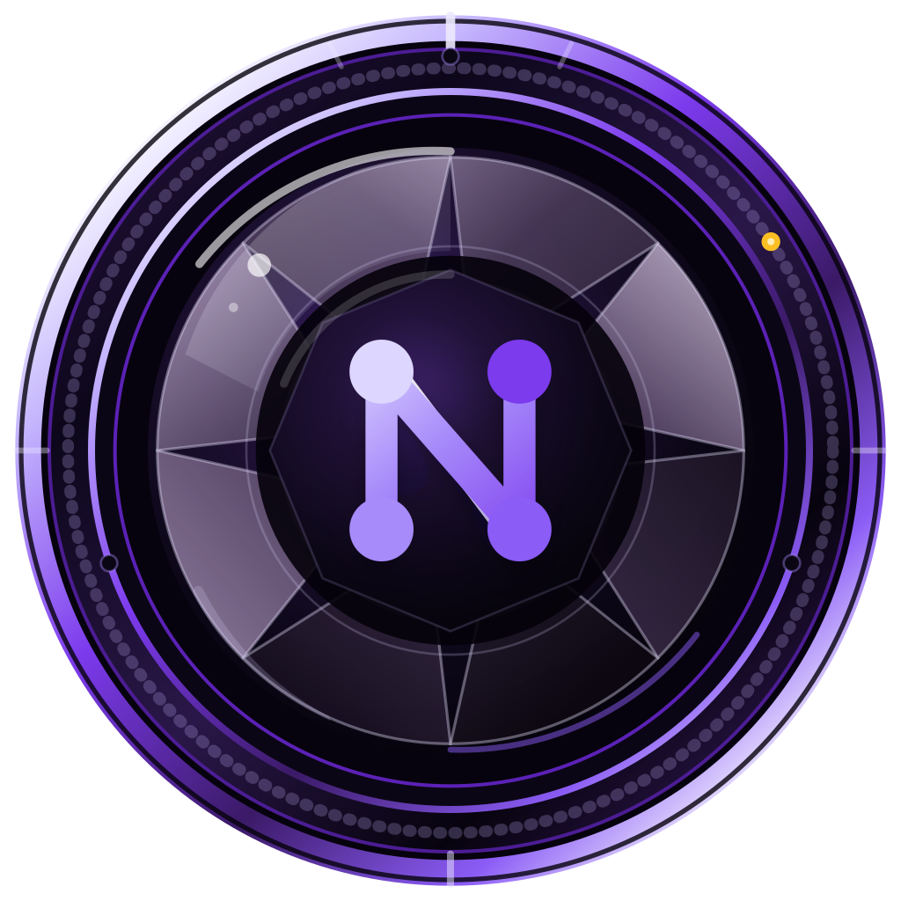
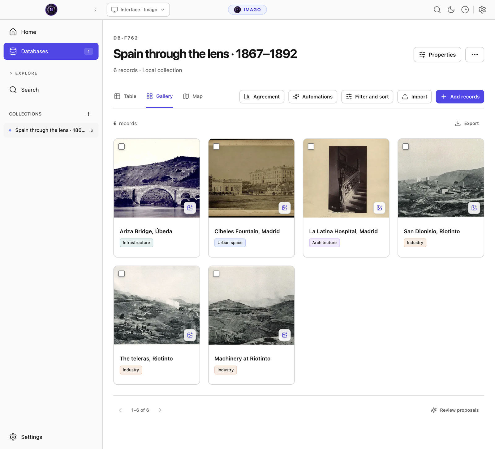
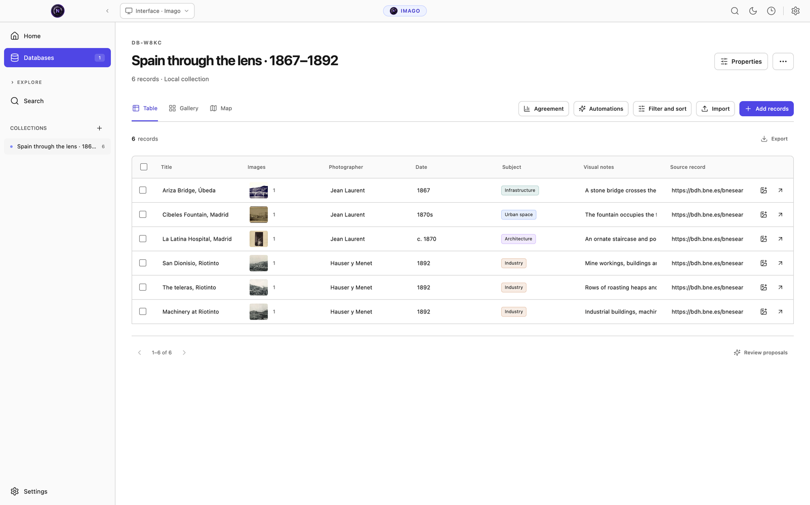
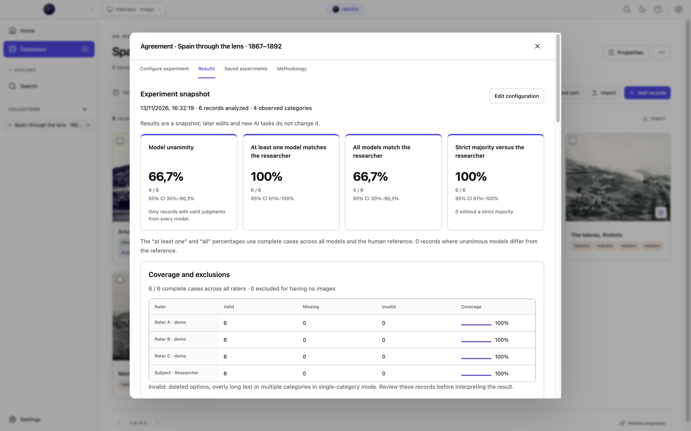
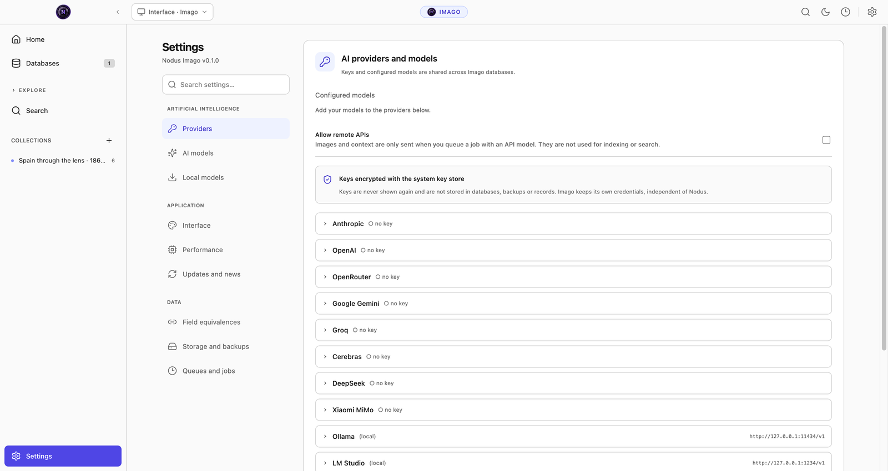

<p align="center">
  
</p>

<h1 align="center">Nodus Imago</h1>
<p align="center"><strong>A desktop application to catalogue, describe and search collections of historical images.</strong></p>
<p align="center">
  <a href="https://github.com/jorgepb96/nodus-imago/actions/workflows/ci.yml"></a>
  <a href="LICENSE"></a>
  <a href="https://github.com/jorgepb96/nodus"></a>
</p>

Nodus Imago is an open-source desktop application for people who research with images, for example in history, art history or archives. It stores your images and their catalogue records in databases on your computer. With them you can describe each image, classify it, search for it by words or by what it shows, and analyse the collection.

Imago is a separate application from [Nodus Research](https://github.com/jorgepb96/nodus). It uses the same interface, settings and themes, but you do not need Nodus to use it.

Everything is stored on your computer. You do not need an account or a server. AI features can run locally without Python; external AI providers are only used if you turn them on.



## Get started

Imago is in development at version **0.1.0**. Test installers and their validation reports are available in [GitHub Actions](https://github.com/jorgepb96/nodus-imago/actions/workflows/ci.yml) in the formats below. They are for testing; a signed public release has not been published yet.

| Platform | Test installer formats |
| --- | --- |
| macOS · Apple silicon | DMG, ZIP |
| macOS · Intel | DMG, ZIP |
| Windows 10/11 · x64 | NSIS installer |
| Linux · x64 or ARM64 | AppImage, DEB, RPM |

You can also [run Imago from source](#development).

The first time you open Imago, an introduction asks you to choose the language (Spanish or English), explains the main features and asks how you want to turn on semantic search: with a model on your computer, with an external provider, or not for now. A guided tour then points out each part of the screen. You can repeat both from **Settings › Interface**.

## Import your catalogue

A database is a table: each row is a record and each column is a property (title, date, place, subjects, and so on). Each record can have one or more images.

- **From a table.** Import a CSV or TSV file, a Notion export or a compatible Nodus database. When you import a CSV, Imago suggests a type for each column (text, number, date, select, multi-select, location…) and you can change any of them before importing.
- **Images.** Import image files or a folder, or drag them into an open database. Imago matches each image to the record whose identifier matches the file or folder name; images without a clear match are listed for you to review. You choose whether Imago keeps its own copy or links to your original file. Imago never modifies originals: it reads their EXIF metadata, creates thumbnails and uses file hashes to detect duplicates. Supported formats: JPEG, PNG, WebP, TIFF, BMP, HEIC and HEIF.

## Work with a database

Each database has five views of the same records:

| View | What it shows |
| --- | --- |
| **Table** | One row per record and one column per property. You can edit cells directly. |
| **Gallery** | One card per record with its main image. |
| **Map** | Records that have a location property, grouped by place. |
| **Timeline** | Records ordered by year, using a date property that Imago detects or you choose. |
| **Statistics** | Calculations on the records shown: see [Analyse the collection](#analyse-the-collection). |



In the table you can drag a column name to move the column and drag its edge to change its width. Right-clicking a column name opens a menu to rename it, change its type, filter, sort, calculate a total for the column, freeze it, hide it, wrap its text, insert a column, duplicate it or delete it. The **Visible properties** button lists every property with a switch to show or hide it.

Opening a record shows its images, properties and notes in a side panel. You can attach several images to a record and write notes in a text editor with formatting.

For locations, you can choose a place from an offline list, type your own name or enter coordinates. The map shows place names and coordinates offline; the OpenStreetMap background needs a connection or previously stored tiles.

**Filter and sort** applies to all views, and you can save a set of criteria to return to it later.

## Search

Imago has two search boxes: **Search** in the left menu looks in all your databases, and the box at the top of each database looks only in that database and narrows its views to the matching records. Both offer three types of search:

- **Literal:** finds the records that contain every word you type, ignoring accents and capital letters.
- **Semantic:** compares a description, for example “night procession with lanterns”, with the content of the images and with the text of the records, and sorts the results by similarity. In the global search you can also attach an image to find similar ones.
- **Hybrid:** shows the records that contain the words together with those closest in meaning.

Semantic search needs an embedding model, which converts each image and each record into a numerical representation that can be compared. Imago indexes new and edited records automatically. The index is stored on your computer. Literal search always works, with or without models.

## Describe and classify with AI

AI features work on your database properties. For a selection of records or a whole column, you can ask a model to write a description or to assign categories from the vocabulary you defined for that property. You choose the model and the instructions for each property. For example, one column can hold descriptions and several other columns can hold the categories assigned by different models to the same images.

AI results are saved as **suggestions**. You review and approve them one by one or in batches; nothing changes in your data until you approve it. Imago records which model and which instructions produced each suggestion.

Long operations (imports, model downloads, indexing, AI analysis) run in the background as tasks. The **Tasks** button in the top bar shows their progress and lets you pause, resume or cancel them.

**Automations** can fill in values, copy properties or start an AI analysis when records change or on a schedule. An execution history shows what ran and its result.

## Compare models and your own classification

The **Agreement** tool shows how consistently your records have been classified. It compares the categories assigned by several models with each other and, if you provide one, with your own classification. It shows how often all models agree, the agreement between each pair and the agreement of each model with you, and lists the records where they differ so you can open them.

The available measures are Cohen’s kappa, Fleiss’ kappa, nominal Krippendorff’s alpha and comparisons for properties with several labels. You choose how missing values are handled, and each result shows how many records it is based on, including results per category. Saving an analysis keeps a copy of its data and settings, which you can export as CSV or JSON; later changes to the database do not change a saved analysis.



*The screenshot uses illustrative labels entered for the demo. Its figures are not an evaluation of any AI model or a research finding.*

## Analyse the collection

The **Statistics** view calculates the following on the records currently shown, after filters and the database search box:

- **Frequencies:** how many records have each value of a property.
- **Cross-tab:** how two properties relate, with Pearson’s chi-square test, its p-value, degrees of freedom and Cramér’s V. A heatmap can show counts, row percentages or standardised residuals (cells beyond ±1.96 differ significantly from what independence would give).
- **Co-occurrence:** which labels of a multi-select property appear together in the same records, with the Jaccard index and lift.
- **Trend:** the number of records per year or decade, optionally split by a property.
- **Numeric:** mean, median, standard deviation and a histogram of a number property.

Each result includes its data table, which you can copy. You can save calculations with the database to open them again later.

## Choose local AI or an external provider

| Purpose | Local model |
| --- | --- |
| Image descriptions and classification | LFM3-VL-2B through llama.cpp |
| Text and image embeddings | EmbeddingGemma 2 through Transformers.js / ONNX Runtime |
| Embeddings on Intel Macs | Harrier OSS v1 0.6B through llama.cpp; images are searched through local LFM3 descriptions |

Models are **downloaded when you ask for them**, not included in the installer. Before a download starts, the model manager shows where the files come from, their license, size and destination, and checks that there is enough disk space. Downloads can be cancelled and resumed, and files are verified with SHA-256 before use. Local models do not need Python.

Instead of a local model, you can use OpenRouter, Google Gemini or another supported provider, or connect Ollama, LM Studio or an OpenAI-compatible server. This also applies to embeddings for semantic search, which is useful on computers with little memory. External providers are disabled until you turn them on; when you use one, the images or texts it processes are sent to it. Provider keys are stored in the operating system’s encrypted storage, separately from the keys you use in Nodus Research.



## Back up and export

You can export tables as CSV, JSON or XLSX. A full `.imago` backup keeps the database structure, the available originals, relations, notes, suggestions, history and search index. In **Settings › Storage and backups** you choose a folder and a schedule; backups can be encrypted and are checked after they are written. If backups are set up, Imago makes one and checks it before installing an update. After restoring a backup, automations and external AI stay disabled until you turn them on again.

When importing from Notion, Imago keeps the exported Markdown pages and their nested blocks along with tables and images. When importing from Nodus, it works from a copy and does not change the original database. In both cases, what can be imported depends on what the export contains.

## Development

To work on Imago you need **Node.js 22.12 or later** and npm. If no prebuilt SQLite module is available for your platform, you may also need its native build tools. Install the dependencies and start the development application with:

```sh
npm ci
npm run dev
```

To build and run the compiled application:

```sh
npm run build
npm start
```

Imago is built with Electron, React, TypeScript and SQLite. Installing the dependencies prepares the native modules for Electron. The main checks are:

```sh
npm run verify             # Typecheck, lint, unit tests and build
npm run test:desktop:all   # Desktop flows; requires a graphical session
npm run test:native-ai:e2e # Real local AI; see the test setup below
```

The [CI workflow](.github/workflows/ci.yml) tests the source and the packaged applications, including real CPU inference, on all five platforms and architectures. Tests with real models need an isolated profile and explicitly downloaded dependencies; the workflow shows how that environment is prepared. To build installers, run the command for your system:

```sh
npm run dist:mac       # macOS Apple silicon: DMG and ZIP
npm run dist:mac:x64   # macOS Intel: DMG and ZIP
npm run dist:win       # Windows x64: NSIS
npm run dist:linux     # Linux native architecture: AppImage, DEB and RPM
```

The [verification record](docs/VERIFICATION.md) describes what has been tested and what has not. RPM executables have been extracted and tested on Ubuntu, but native installation on an RPM distribution and updating between signed releases have not been verified yet. Some engineering reports are in Spanish.

## Report a problem

To report a problem or suggest a feature, [open an issue](https://github.com/jorgepb96/nodus-imago/issues). For a problem, please include your app version and platform, the steps that reproduce it and what you expected to happen. A small anonymised example helps; do not include private research material or API keys.

## Image credits

**Images taken from the holdings of the Biblioteca Nacional de España.** The historical photographs shown here come from the Biblioteca Digital Hispánica and were retrieved through Wikimedia Commons. Their [individual sources, rights and screenshot notes](docs/screenshots/README.md) are documented separately. English display titles and research annotations were prepared for the demonstration. The BNE does not sponsor or endorse Nodus Imago.

## License

Nodus Imago is © Jorge Pérez Burgueño and licensed under [AGPL-3.0-only](LICENSE). Adapted Nodus components keep their attribution; see the [reuse notes](docs/REUSE.md) and [third-party notices](THIRD_PARTY_NOTICES.md). Dependencies, photographs and optional models keep their own licenses. LFM3 uses the [LFM Open License 1.0](legal/LFM-Open-License-1.0.txt); model weights are not included with the app.
