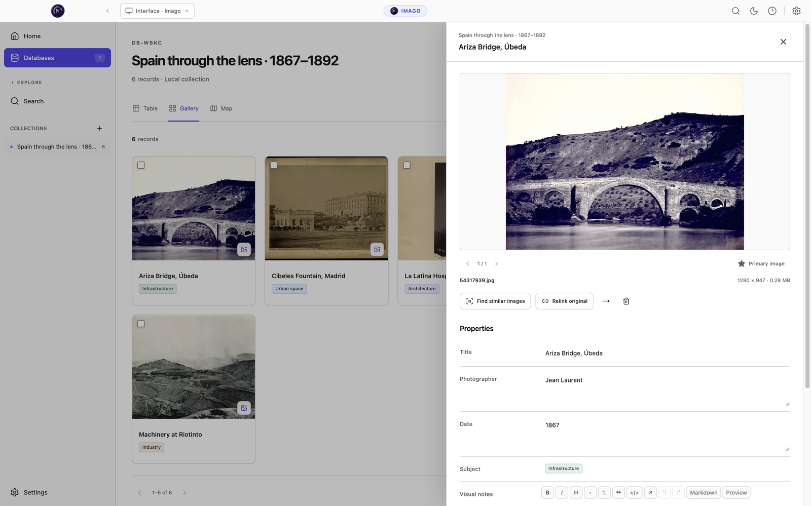

<p align="center">
  
</p>

<h1 align="center">Nodus Imago</h1>
<p align="center"><strong>Research through images.</strong></p>
<p align="center">
  <a href="https://github.com/jorgepb96/nodus-imago/actions/workflows/ci.yml"></a>
  <a href="LICENSE"></a>
  <a href="https://github.com/jorgepb96/nodus"></a>
</p>

Nodus Imago is an open-source desktop application for researchers working with visual sources. Build a photographic corpus, catalogue its contents, describe and classify images, and compare interpretations without separating the image from its documentary context.

Designed for history, art history, archival research and other fields that work with images, Imago combines flexible databases with optional AI assistance and tools for systematic human review. It is a standalone sister app to [Nodus Research](https://github.com/jorgepb96/nodus), with the same familiar sidebar, header, settings and themes. You do not need Nodus installed to use it.

Your collection and search indexes stay on your computer. No account or server is required. Local AI runs without Python; online providers are optional and only used when you enable them and queue a task with a remote model.


## Get started

Imago is currently in development, version **0.1.0**. Test installers and validation reports are available in [GitHub Actions](https://github.com/jorgepb96/nodus-imago/actions/workflows/ci.yml). These are development artifacts; a signed public release has not yet been published.

| Platform | Test installer formats |
| --- | --- |
| macOS · Apple silicon | DMG, ZIP |
| macOS · Intel | DMG, ZIP |
| Windows 10/11 · x64 | NSIS installer |
| Linux · x64 or ARM64 | AppImage, DEB, RPM |

You can also [run Imago from source](#development). Begin with a new database or import an existing CSV, TSV, Notion export or compatible Nodus database. Add images, choose your properties and start cataloguing. Keyword search works immediately, without downloading a model.

## Build a visual research corpus

Work with **Table, Gallery and Map** views of the same records. Add dates, controlled vocabularies, multiple tags, locations, relations, formulas and rollups. Combine filters, sort by several properties and save criteria you can return to throughout a project.

Import image files or folders, drag them into a database, and match them to existing records by filename or catalogue reference. Keep a managed copy or link an existing original. Imago extracts EXIF metadata, generates previews and detects duplicates using file hashes. JPEG, PNG, WebP, TIFF, BMP, HEIC and HEIF are supported.


Open a record to inspect its images alongside its properties and notes. Use the visual rich-text editor for commentary, preserve links to the source catalogue, and keep several images attached to the same record.



Location fields offer offline place suggestions, custom entries and manual coordinates. Map views group nearby records and let you open their images from a marker. Place names and coordinates remain available offline; the OpenStreetMap background needs a connection or previously cached tiles.

Search across one or several databases using words, phrases and filters. With a local embedding model installed, search by meaning, use an image to find similar images, or combine text and visual queries. The semantic index stays local, and keyword search remains available without models.

## Describe, classify and review

Queue descriptions or thematic classifications for selected records or an entire column. Choose a model and instructions for each property: one model can describe an image while others classify it into separate columns using your research vocabulary.

Several queues can run within the configured resource limits. Pause, resume or cancel work from the header, then review proposals individually or in batches. Imago retains their model, instructions and provenance; accepting a proposal is a separate step from generating it.

Opt-in automations can assign values, copy properties or queue AI analysis when records change or on a schedule. Their execution history remains available for inspection.

## Compare models and human judgments

The **Agreement** workspace compares classification columns with one another and with an optional independent human reference. Measure unanimity, pairwise agreement and agreement with the researcher; inspect disagreements instead of reducing an experiment to a single percentage.

Tools include Cohen’s kappa, Fleiss’ kappa, nominal Krippendorff’s alpha and multilabel comparisons. Choose how to handle missing judgments, inspect denominators and category-level results, and save an experiment snapshot with CSV or JSON exports. Later edits do not rewrite a saved result.


*The screenshot uses illustrative labels entered for the demo. Its figures are not an evaluation of any AI model or a research finding.*

## Choose local AI or your own provider

| Purpose | Local model |
| --- | --- |
| Image descriptions and classification | LFM3-VL-2B through llama.cpp |
| Text and image embeddings | EmbeddingGemma 2 through Transformers.js / ONNX Runtime |
| Embeddings on Intel Macs | Harrier OSS v1 0.6B through llama.cpp; images are searched through local LFM3 descriptions |

Model weights are **downloaded on demand**, separately from the installer. The model manager shows their origin, license, size and destination, checks available disk space and verifies SHA-256 integrity. Downloads support cancellation and resumption. The main local workflow does not require Python.

You can also configure OpenRouter, Google Gemini and other supported providers, or connect Ollama, LM Studio and an OpenAI-compatible endpoint. Remote APIs are disabled by default. Provider keys use the operating system’s encrypted storage and remain independent of Nodus Research credentials.


## Preserve and move your work

Export tables as CSV, JSON or XLSX. Native `.imago` backups preserve the database structure, available originals, relations, annotations, proposals, history and search vectors. Configure a backup folder and schedule, use encrypted copies, and verify integrity before restoring. Restored automation rules and remote AI remain disabled until you choose to enable them again.

Notion imports preserve exported Markdown pages and their nested block structure alongside tables and images. Nodus imports read a consistent copy without modifying the original database. Neither import can reconstruct information absent from its source export.

## Development

Use **Node.js 22.12 or later** and npm. Native build tools may be needed if a prebuilt SQLite module is unavailable for your platform.

```sh
npm ci
npm run dev
```

To build and run the compiled application:

```sh
npm run build
npm start
```

Electron, React, TypeScript and SQLite form the desktop stack. Installation prepares native dependencies for Electron’s ABI.

```sh
npm run verify             # Typecheck, lint, unit tests and build
npm run test:desktop:all   # Desktop flows; requires a graphical session
npm run test:native-ai:e2e # Real local AI; see the test setup below
```

The [CI workflow](.github/workflows/ci.yml) builds and exercises source, packaged applications and real CPU inference on all five platform/architecture targets. Real-AI tests need an isolated profile and explicitly downloaded model dependencies; consult the workflow for their environment and invocation. Installer builds should run on their target system:

```sh
npm run dist:mac       # macOS Apple silicon: DMG and ZIP
npm run dist:mac:x64   # macOS Intel: DMG and ZIP
npm run dist:win       # Windows x64: NSIS
npm run dist:linux     # Linux native architecture: AppImage, DEB and RPM
```

See the [verification record](docs/VERIFICATION.md) for evidence and limits. RPM executables have been extracted and tested on Ubuntu; native installation on an RPM distribution and installation between signed releases remain unverified. Historical engineering reports currently include Spanish-language material.

## Contribute and report issues

[Open an issue](https://github.com/jorgepb96/nodus-imago/issues) to report a reproducible problem or suggest a research workflow. Include the app version, platform, steps and expected behaviour. Use a small anonymised example rather than private research material or API credentials.

## Image credits

**Imágenes procedentes de los fondos de la Biblioteca Nacional de España.** Images taken from the holdings of the Biblioteca Nacional de España, made available through the Biblioteca Digital Hispánica. See the [individual sources, rights and screenshot notes](docs/screenshots/README.md). The demo catalogue uses English display titles and illustrative research annotations. The BNE does not sponsor or endorse Nodus Imago.

## License

Nodus Imago is © Jorge Pérez Burgueño and licensed under [AGPL-3.0-only](LICENSE). Adapted Nodus components retain their attribution; see [reuse notes](docs/REUSE.md) and [third-party notices](THIRD_PARTY_NOTICES.md). Dependencies, photographs and optional models retain their own licenses. LFM3 uses the [LFM Open License 1.0](legal/LFM-Open-License-1.0.txt); model weights are not bundled with the app.
